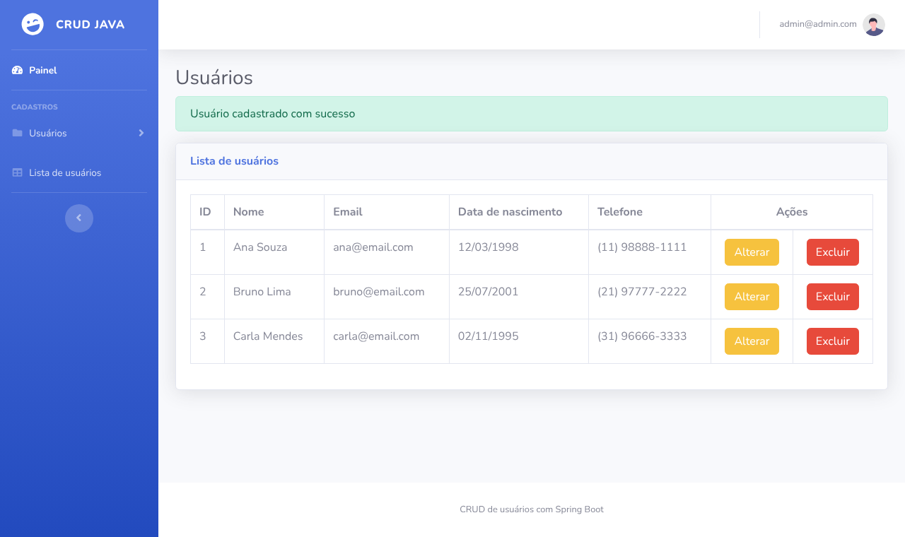
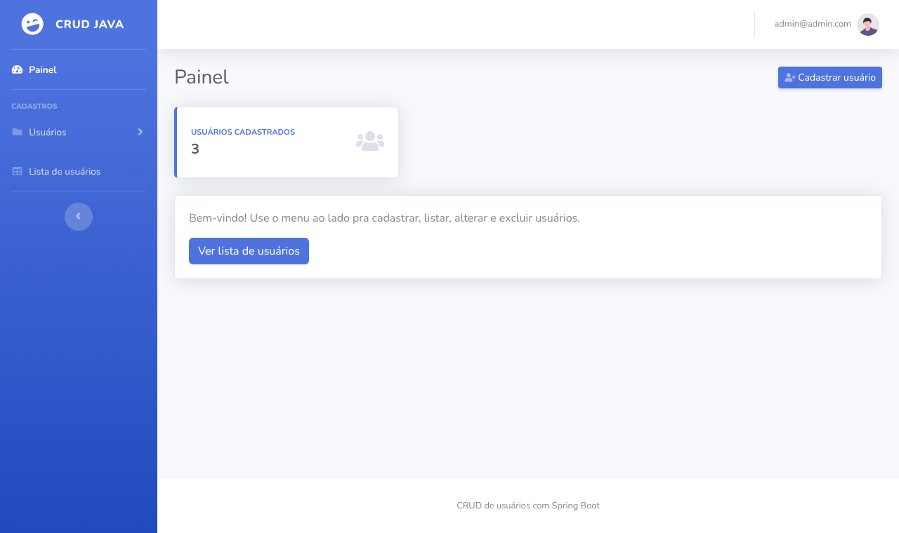
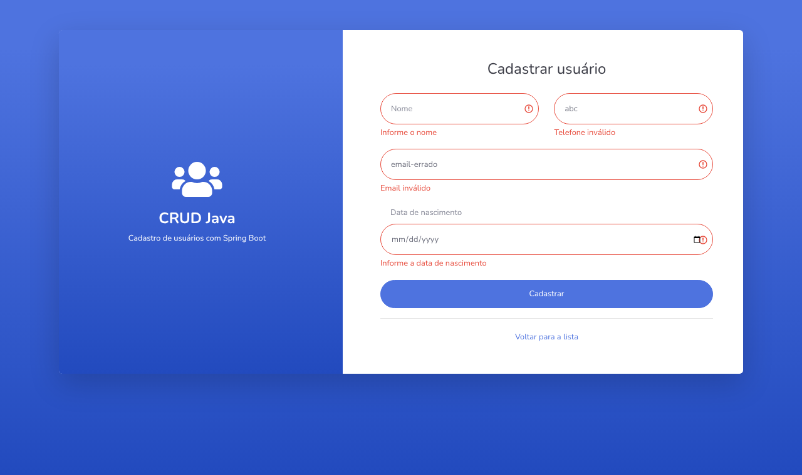

# CRUD Java

Aplicação web de cadastro de usuários feita com Spring Boot, Thymeleaf e MySQL. Tem login com Spring Security, criação de conta com senha criptografada e um CRUD completo de usuários, com validação nos formulários.

Começou como projeto da SENAI em 2023 e foi atualizado em 2026.



## Funcionalidades

- Login e criação de conta, com senha guardada como hash BCrypt
- Cadastrar, listar, alterar e excluir usuários (nome, email, telefone e data de nascimento)
- Validação dos campos com mensagem de erro embaixo de cada um
- Painel com o total de usuários cadastrados
- Proteção CSRF em todos os formulários

## Tecnologias

- Java 17
- Spring Boot 3.5 (Web, Data JPA, Validation, Security)
- Thymeleaf com o template [SB Admin 2](https://github.com/StartBootstrap/startbootstrap-sb-admin-2) (licença MIT)
- MySQL em produção e H2 em memória no desenvolvimento e nos testes
- Lombok
- JUnit 5, MockMvc e Spring Security Test

## Como rodar

Precisa ter o Java 17 ou mais novo instalado. O Maven vem junto no projeto (`mvnw`).

### Sem instalar banco (perfil dev)

O perfil `dev` usa um banco H2 em memória e já cria uma conta de teste:

```bash
./mvnw spring-boot:run -Dspring-boot.run.profiles=dev
```

Abra http://localhost:8080 e entre com `admin@admin.com` / `admin123`. Os dados somem quando a aplicação para. O console do H2 fica em http://localhost:8080/h2-console (JDBC URL `jdbc:h2:mem:primeira_aplicacao_web`, usuário `sa`, sem senha).

### Com MySQL

Crie o banco:

```sql
CREATE DATABASE primeira_aplicacao_web;
```

A conexão é configurada por variáveis de ambiente. Se elas não existirem, a aplicação usa `root` sem senha no MySQL local.

| Variável | Padrão |
| --- | --- |
| `DB_URL` | `jdbc:mysql://localhost:3306/primeira_aplicacao_web` |
| `DB_USERNAME` | `root` |
| `DB_PASSWORD` | vazio |

```bash
DB_PASSWORD=sua_senha ./mvnw spring-boot:run
```

As tabelas são criadas sozinhas na primeira execução. Depois é só abrir http://localhost:8080 e criar uma conta em "Criar uma conta".

No Windows, use `mvnw.cmd` no lugar de `./mvnw`.

## Testes

```bash
./mvnw test
```

Os testes rodam com H2, então não precisam de MySQL. Eles cobrem cadastro válido e inválido, alteração, exclusão, bloqueio de páginas sem login, criação de conta e login.

## Estrutura

```
src/main/java/com/senai/primeiraaplicacaoweb
├── config/        SecurityConfig e a conta de teste do perfil dev
├── controller/    Home, Login (entrar e criar conta) e User (CRUD)
├── model/         UserModel, ContaModel e RegistroForm
├── repository/    Repositórios Spring Data JPA
└── service/       Regras de negócio e carregamento da conta pro login
```

## Telas

| Login | Painel |
| --- | --- |
|  |  |

| Validação no cadastro |
| --- |
|  |
